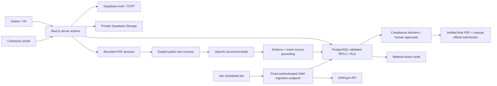

# Architecture

## Trust boundaries

The browser is untrusted. Forms and hidden IDs never grant permissions. Server actions validate input and origin, verify the session against Supabase, then use the user's JWT for database/storage operations. Ordinary requests never use the service-role key.

PostgreSQL is the authorization and integrity boundary: organizations, composite tenant foreign keys, role/MFA checks, contractor ownership, immutable approval history and dedicated mutation functions. Users receive SELECT plus narrowly enumerated EXECUTE privileges, not table mutation privileges. `SECURITY DEFINER` functions have an empty search path and qualified object references. The private schema is excluded from the REST API.

AI is outside the trust boundary. Public text is processed only after explicit consent. The model has no tools, credentials, approval authority or access to contractor files. Exact excerpts and pages are checked mechanically; semantic correctness remains a human responsibility. All extracted requirements start MISSING. Proposals are generated deterministically from verified facts and requirement responses rather than unconstrained AI prose.

An external worker token permits only a fixed source ingestion route. Its organization and source endpoint are server-configured; a caller cannot choose a target URL, database role or arbitrary RPC. Integration service credentials still have broad administrative privileges and must remain in a dedicated server secret binding.

## Revision model

Changes to opportunity metadata, requirements, source documents, current contractor information and verified company facts advance the opportunity revision. Existing pricing, proposals and downstream approvals become stale. New source PDFs/amendments reopen all mandatory requirements. Pursue approval is a continuing authorization to investigate, not a statement of eligibility or submission approval.

Final-package uploads bind a PDF to the current revision. The newest package must be verified and valid. Submission approval additionally records its exact immutable document ID. Uploading another PDF cannot inherit the old approval. A subsequent business change makes the package stale. Explicit approval revocation advances the revision. Closed dossiers reject new requirements, proposals, pricing and opportunity document uploads.

Submitted artifacts and approvals remain historical records. A later expired/revoked contractor document cannot undo a real-world submission; it becomes an exception for subsequent activity. The application never submits bids autonomously.

## Components and sources

Schema and RPCs: `supabase/migrations/`. Prompts and strict output schemas: `src/lib/ai.ts` / `src/lib/domain.ts`. PDF isolation: `scripts/extract-pdf.mjs` / `src/lib/pdf.ts`. Workflows: `n8n/`. Deployment-specific secrets, live providers, storage guarantees and admin roles must be configured separately in each environment.
